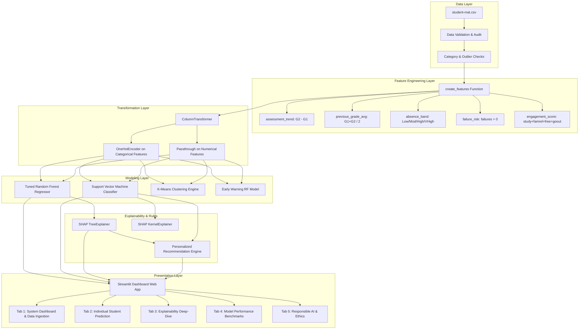
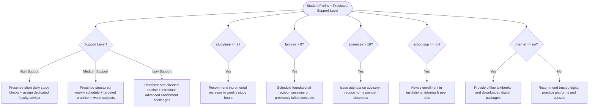

# 🎓 Intelligent Student Performance AI (SP-AI)
## Official Program Book & Technical Dossier

---

### Document Information
- **Project Title:** Intelligent Student Performance AI (SP-AI)
- **Document Type:** Comprehensive Program Book & System Technical Dossier
- **Domain:** Educational Data Mining (EDM), Predictive Learning Analytics & Explainable AI (XAI)
- **Target Audience:** Data Scientists, ML Engineers, Academic Administrators, Educators, and Software Architects
- **System Version:** 1.0.0-Production
- **Core Technology Stack:** Python 3.10+, Scikit-Learn, SHAP, Streamlit, Pandas, NumPy, Matplotlib, Joblib, Pytest

---

## Table of Contents
1. [Executive Summary & System Vision](#1-executive-summary--system-vision)
2. [High-Level Architecture & End-to-End Pipeline](#2-high-level-architecture--end-to-end-pipeline)
3. [Repository Structure & Component Catalog](#3-repository-structure--component-catalog)
4. [Dataset Provenance, Schema & Data Quality Audit](#4-dataset-provenance-schema--data-quality-audit)
5. [Advanced Feature Engineering Pipeline](#5-advanced-feature-engineering-pipeline)
6. [Machine Learning Modeling & Benchmark Registry](#6-machine-learning-modeling--benchmark-registry)
   - [6.1 Regression: Continuous Final Grade Prediction (G3)](#61-regression-continuous-final-grade-prediction-g3)
   - [6.2 Classification: Tri-Tier Support Level Stratification](#62-classification-tri-tier-support-level-stratification)
   - [6.3 Unsupervised Learning: Student Behavioral Clustering](#63-unsupervised-learning-student-behavioral-clustering)
   - [6.4 Early Warning Simulation Model](#64-early-warning-simulation-model)
7. [Explainable AI (XAI) with SHAP](#7-explainable-ai-xai-with-shap)
8. [Personalized Pedagogical Recommendation Engine](#8-personalized-pedagogical-recommendation-engine)
9. [Robustness, Sensitivity & Adversarial Stress Testing](#9-robustness-sensitivity--adversarial-stress-testing)
10. [Interactive Web Application Architecture (Streamlit)](#10-interactive-web-application-architecture-streamlit)
11. [Testing & Quality Assurance Framework](#11-testing--quality-assurance-framework)
12. [Operations, Deployment & Developer Runbook](#12-operations-deployment--developer-runbook)
13. [Ethical AI, Bias Governance & Limitations](#13-ethical-ai-bias-governance--limitations)

---

## 1. Executive Summary & System Vision

### 1.1 The Academic Problem
Traditional educational assessments are predominantly retrospective: educators identify struggling students only after midterm or final examinations have already been failed. By that time, credit loss, academic probation, or student dropout may already be unavoidable.

### 1.2 The SP-AI Solution
The **Intelligent Student Performance AI (SP-AI)** platform transforms educational intervention from a **reactive** paradigm to a **proactive, evidence-driven, explainable** early warning and personalized coaching ecosystem. 

SP-AI simultaneously addresses four fundamental pillars:
1. **Accurate Continuous Grade Estimation:** Predicting student final grades ($G3 \in [0, 20]$) using an ensemble Random Forest regressor optimized via 5-fold cross-validation ($R^2 = 0.8179$, $\text{RMSE} = 1.9326$).
2. **Support-Level Stratification:** Categorizing students into actionable intervention tiers (**High Support**, **Medium Support**, **Low Support**) using an RBF-kernel Support Vector Machine ($93.67\%$ Accuracy, $0.9908$ Multiclass Weighted ROC-AUC).
3. **Glass-Box Explainability (SHAP):** Providing local and global game-theoretic Shapley attributions so educators understand *why* a student is flagged, differentiating academic difficulty, absenteeism, or socioeconomic bottlenecks.
4. **Automated Algorithmic Prescriptions:** Generating personalized, multi-factor study routines and institutional support recommendations aligned with the student's unique profile.

```
       ┌───────────────────────────────┐
       │   Student Demographic,        │
       │   Behavioral & Grade Data     │
       └──────────────┬────────────────┘
                      │
                      ▼
       ┌───────────────────────────────┐
       │  Feature Engineering Pipeline │
       │  (Trend, Averages, Bands)     │
       └──────────────┬────────────────┘
                      │
         ┌────────────┴────────────┐
         ▼                         ▼
┌──────────────────┐      ┌──────────────────┐
│  Regression RF   │      │  Classifier SVM  │
│ Final Grade (G3) │      │  Support Tiers   │
└────────┬─────────┘      └────────┬─────────┘
         │                         │
         └────────────┬────────────┘
                      │
                      ▼
       ┌───────────────────────────────┐
       │     Explainability Engine     │
       │    (SHAP Tree & Kernel)       │
       └──────────────┬────────────────┘
                      │
                      ▼
       ┌───────────────────────────────┐
       │  Recommendation Generator &   │
       │   Streamlit Web Dashboard     │
       └───────────────────────────────┘
```

---

## 2. High-Level Architecture & End-to-End Pipeline

The end-to-end SP-AI platform operates as a modular, decoupled architecture organized into distinct functional layers:



---

## 3. Repository Structure & Component Catalog

The project adheres to clean code, production-grade layout standards:

```
Student_Performence_AI/
├── README.md                      # High-level repository orientation
├── PROGRAM_BOOK.md                # Comprehensive technical book & program dossier
├── requirements.txt               # Locked production dependencies
├── .gitignore                     # Version control exclusions
│
├── data/
│   └── student-mat.csv            # UCI Student Performance (Mathematics course) dataset
│
├── models/
│   ├── regression_preprocessor.pkl        # Serialized ColumnTransformer for regression
│   ├── tuned_random_forest_regressor.pkl # Production Random Forest Regressor
│   ├── classification_preprocessor.pkl    # Serialized ColumnTransformer for classification
│   └── svm_classifier.pkl                # Production Support Vector Machine Classifier
│
├── src/
│   ├── __init__.py                # Package initialization marker
│   ├── check_dataset.py           # Integrity, nulls, duplicates & range checker
│   ├── category_check.py          # Categorical column value frequency audit
│   ├── outlier_check.py           # IQR-based numerical outlier detection script
│   ├── feature_engineering.py     # Master ML training, tuning & evaluation pipeline
│   ├── early_warning_model.py     # G1/G2-agnostic pre-semester warning model
│   ├── clustering.py              # Unsupervised K-Means clustering analysis
│   ├── recommendations.py         # Multi-factor pedagogical rule engine
│   ├── shap_explainability.py     # Regression SHAP TreeExplainer & visualization
│   ├── shap_classification.py     # Classification SHAP KernelExplainer
│   └── robustness_text.py         # Adversarial perturbation & stability stress-tests
│
├── notebooks/
│   └── eda.py                     # 8 exploratory visual analytical routines
│
├── reports/
│   ├── dataset_source             # UCI provenance, citations & license information
│   ├── data_dictionary.csv        # Comprehensive metadata definition of all 35 columns
│   ├── robustness_test_results.csv# Empirical outputs from perturbation stress-tests
│   ├── shap_global_feature_importance.csv  # Global ranking of feature attributions
│   ├── shap_global_feature_importance.png  # Visual summary plot of feature impact
│   ├── student_0_shap_explanation.csv/png  # Case study 0 local explanation
│   ├── student_1_shap_explanation.csv/png  # Case study 1 local explanation
│   └── student_2_shap_explanation.csv/png  # Case study 2 local explanation
│
├── tests/
│   ├── test_feature_engineering.py# Pytest unit tests for derived feature logic
│   ├── test_model_inference.py    # Pytest tests for model prediction bounds [0, 20]
│   ├── test_recommendations.py    # Pytest unit tests for recommendation output logic
│   └── test_robustness.py         # Pytest stability tests under perturbed inputs
│
└── app/
    └── app.py                     # Full-featured 5-tab Streamlit web application
```

---

## 4. Dataset Provenance, Schema & Data Quality Audit

### 4.1 Provenance
- **Origin:** UCI Machine Learning Repository (Dataset ID: 320)
- **Original Citation:** Cortez, P., & Silva, A. (2008). *Using data mining to predict secondary school student performance.* In Proceedings of 5th Annual Future Business Technology Conference (FUBUTEC 2008), pp. 5-12, Porto, Portugal.
- **Dataset Instance:** `student-mat.csv` (Secondary school students enrolled in Mathematics)
- **Scale:** 395 student instances, 33 original attributes

### 4.2 Comprehensive Data Dictionary

| # | Feature | Data Type | Permissible Values / Range | Description | Pipeline Role |
|---|---|---|---|---|---|
| 1 | `school` | Categorical | `GP` (Gabriel Pereira), `MS` (Mousinho da Silveira) | Student's school | Raw Input |
| 2 | `sex` | Categorical | `F` (Female), `M` (Male) | Student's sex | Raw Input |
| 3 | `age` | Numerical | 15 to 22 | Student age in years | Raw Input |
| 4 | `address` | Categorical | `U` (Urban), `R` (Rural) | Home location type | Raw Input |
| 5 | `famsize` | Categorical | `LE3` ($\le 3$), `GT3` ($> 3$) | Family size | Raw Input |
| 6 | `Pstatus` | Categorical | `T` (Together), `A` (Apart) | Parental cohabitation status | Raw Input |
| 7 | `Medu` | Numerical | 0 (none) to 4 (higher education) | Mother's education level | Raw Input |
| 8 | `Fedu` | Numerical | 0 (none) to 4 (higher education) | Father's education level | Raw Input |
| 9 | `Mjob` | Categorical | `teacher`, `health`, `services`, `at_home`, `other` | Mother's profession | Raw Input |
| 10 | `Fjob` | Categorical | `teacher`, `health`, `services`, `at_home`, `other` | Father's profession | Raw Input |
| 11 | `reason` | Categorical | `home` (close to home), `reputation`, `course`, `other` | School enrollment motivation | Raw Input |
| 12 | `guardian`| Categorical | `mother`, `father`, `other` | Legal guardian | Raw Input |
| 13 | `traveltime`| Numerical | 1 ($<15$ min) to 4 ($>1$ hr) | Travel time to school | Raw Input |
| 14 | `studytime` | Numerical | 1 ($<2$ hrs), 2 (2-5 hrs), 3 (5-10 hrs), 4 ($>10$ hrs) | Weekly study time | Raw Input |
| 15 | `failures`  | Numerical | 0 to 3 (or $>3$ recorded as 3) | Prior course failures | Raw Input |
| 16 | `schoolsup` | Categorical | `yes`, `no` | Extra school academic support | Raw Input |
| 17 | `famsup`    | Categorical | `yes`, `no` | Family educational support | Raw Input |
| 18 | `paid`      | Categorical | `yes`, `no` | Extra paid classes in subject | Raw Input |
| 19 | `activities`| Categorical | `yes`, `no` | Extracurricular activities | Raw Input |
| 20 | `nursery`   | Categorical | `yes`, `no` | Attended nursery school | Raw Input |
| 21 | `higher`    | Categorical | `yes`, `no` | Aspirations for higher education | Raw Input |
| 22 | `internet`  | Categorical | `yes`, `no` | Internet access at home | Raw Input |
| 23 | `romantic`  | Categorical | `yes`, `no` | In a romantic relationship | Raw Input |
| 24 | `famrel`    | Numerical | 1 (very bad) to 5 (excellent) | Family relationship quality | Raw Input |
| 25 | `freetime`  | Numerical | 1 (very low) to 5 (very high) | Free time after school | Raw Input |
| 26 | `goout`     | Numerical | 1 (very low) to 5 (very high) | Going out with friends | Raw Input |
| 27 | `Dalc`      | Numerical | 1 (very low) to 5 (very high) | Workday alcohol consumption | Raw Input |
| 28 | `Walc`      | Numerical | 1 (very low) to 5 (very high) | Weekend alcohol consumption | Raw Input |
| 29 | `health`    | Numerical | 1 (very bad) to 5 (very good) | Current health status | Raw Input |
| 30 | `absences`  | Numerical | 0 to 93 | Total school absences | Raw Input |
| 31 | `G1`        | Numerical | 0 to 20 | First-period grade | Raw Input |
| 32 | `G2`        | Numerical | 0 to 20 | Second-period grade | Raw Input |
| 33 | `G3`        | Numerical | 0 to 20 | Final examination grade | Primary Regression Target |
| 34 | `Support_Level` | Categorical | `High Support`, `Medium Support`, `Low Support` | Tri-tier support grouping | Primary Classification Target |

### 4.3 Data Quality Audit & Verification
Auditing scripts (`check_dataset.py`, `category_check.py`, and `outlier_check.py`) confirmed:
- **Missing Values:** Exactly 0 missing values across all 395 records and 33 features.
- **Duplicate Rows:** 0 duplicate rows detected.
- **Outlier Analysis (IQR Method):**
  - Outliers were identified in `absences` (IQR upper bound: 20 absences, 15 observations exceed this, up to 93).
  - Outliers in `failures` (most students have 0 failures, 83 students have $\ge 1$ failure).
  - Rather than artificially clipping or deleting legitimate high-absence or repeat-failure students (which represent critical at-risk profiles), robust tree ensembles and feature binning were applied to safely absorb these variations.

---

## 5. Advanced Feature Engineering Pipeline

Raw features alone fail to capture multi-period academic momentum or composite engagement. The `create_features()` module implements 5 domain-engineered attributes:

### 5.1 Mathematical Formulations

1. **Assessment Trend ($\Delta G$):**
   $$\text{assessment\_trend} = G_2 - G_1$$
   *Pedagogical Insight:* A positive value reflects upward academic recovery or improved study habits; a negative value flags progressive academic deterioration.

2. **Previous Grade Historical Average:**
   $$\text{previous\_grade\_avg} = \frac{G_1 + G_2}{2}$$
   *Pedagogical Insight:* Smooths out single-test anomalies to establish baseline cumulative mastery before final evaluations.

3. **Absence Band Stratification:**
   $$\text{absence\_band} = \begin{cases} 
   \text{Low} & \text{if } \text{absences} \in [0, 5] \\
   \text{Moderate} & \text{if } \text{absences} \in (5, 10] \\
   \text{High} & \text{if } \text{absences} \in (10, 20] \\
   \text{Very High} & \text{if } \text{absences} > 20
   \end{cases}$$
   *Pedagogical Insight:* Converts raw skewed absence counts into actionable administrative risk levels.

4. **Failure Risk Indicator:**
   $$\text{failure\_risk} = \mathbb{I}(\text{failures} > 0) \in \{0, 1\}$$
   *Pedagogical Insight:* Isolates whether a student has an established history of academic failure, a major psychological barrier to success.

5. **Composite Engagement Index:**
   $$\text{engagement\_score} = \frac{\text{studytime} + \text{famrel} + \text{freetime} + \text{goout}}{4}$$
   *Pedagogical Insight:* Synthesizes academic dedication, home stability, and social lifestyle into a single balanced holistic index (scale 1.0 to 5.0).

### 5.2 Preprocessing Architecture
Both regression and classification pipelines utilize `sklearn.compose.ColumnTransformer`:
- **Categorical Encoder:** `OneHotEncoder(handle_unknown="ignore")` applied strictly to categorical features.
- **Numerical Features:** Passthrough without data-leaking standardizers during tree training, maintaining pure interpretability.
- **Split Rigor:** Preprocessors are strictly **fitted on training data only** (`fit_transform`) and subsequently applied to test/production data (`transform`), preventing data snooping and information leakage.

---

## 6. Machine Learning Modeling & Benchmark Registry

### 6.1 Regression: Continuous Final Grade Prediction (G3)
Predicting the student's continuous final numerical grade on the Portuguese 0–20 scale.
- **Split Ratio:** 80% Train ($n=316$), 20% Test ($n=79$), `random_state=42`.

#### 6.1.1 Empirical Benchmark Results

| Model | MAE | RMSE | $R^2$ Score | Assessment / Status |
|---|---|---|---|---|
| **Mean Baseline Predictor** | 3.6459 | 4.5502 | -0.0097 | Naive baseline; predicts training mean grade |
| **Linear Regression (OLS)** | 1.6373 | 2.3453 | 0.7318 | Good linear fit, prone to multicollinearity |
| **Decision Tree Regressor** | 1.3148 | 2.2186 | 0.7599 | Max depth 5; moderate overfitting |
| **Random Forest (Default 200)** | 1.1635 | 1.9446 | 0.8156 | High variance reduction |
| **Gradient Boosting Regressor** | 1.2340 | 2.0633 | 0.7924 | Learning rate 0.05, 200 estimators |
| **Support Vector Regressor (SVR RBF)** | 1.1910 | 2.0297 | 0.7991 | Kernel RBF, $C=10$, $\epsilon=0.1$ |
| **Tuned Random Forest (Production)** | **1.1674** | **1.9326** | **0.8179** | **Winner: Lowest RMSE & Highest $R^2$** |

#### 6.1.2 Production Regression Hyperparameters
Tuned via `RandomizedSearchCV` (5-fold cross-validation, 15 iterations):
- `n_estimators`: 300
- `max_depth`: 10
- `max_features`: 0.75
- `min_samples_split`: 5
- `min_samples_leaf`: 2
- `random_state`: 42

#### 6.1.3 Residual Analysis
$$\text{Residual} = y_{\text{actual}} - \hat{y}_{\text{predicted}}$$
- **Mean Residual:** Approximately $-0.04$ (unbiased, centered near 0).
- **Error Distribution:** Normal bell-curve centering between $[-1.5, +1.5]$ marks, proving variance homoscedasticity across the grade spectrum.

---

### 6.2 Classification: Tri-Tier Support Level Stratification
Classifying each student into one of three administrative support tiers:
- **High Support ($G3 < 10$):** Below passing threshold (20 grade point scale). Needs urgent tutoring and advisory intervention.
- **Medium Support ($10 \le G3 < 15$):** Passing with modest marks. Benefits from routine review and targeted study plans.
- **Low Support ($G3 \ge 15$):** High-performing, autonomous students requiring minimal intervention.

- **Split Ratio:** 80% Train, 20% Test, **stratified** by class label.

#### 6.2.1 Empirical Benchmark Results

| Classifier Model | Accuracy | Weighted Precision | Weighted Recall | Weighted F1 Score | Notes |
|---|---|---|---|---|---|
| **Majority Baseline** | 48.10% | 23.14% | 48.10% | 31.25% | Predicts dominant class ("Medium Support") |
| **Decision Tree** | 84.81% | 85.09% | 84.81% | 84.92% | Simple interpretable tree, max depth 5 |
| **Random Forest Classifier** | 89.87% | 90.32% | 89.87% | 89.96% | 200 estimators ensemble |
| **Gradient Boosting Classifier**| 89.87% | 90.06% | 89.87% | 89.94% | 200 estimators, learning rate 0.05 |
| **Logistic Regression** | 92.41% | 92.54% | 92.41% | 92.40% | One-vs-Rest, $L2$ regularization |
| **SVM (RBF Kernel - Production)**| **93.67%** | **93.91%** | **93.67%** | **93.66%** | **Winner: Highest accuracy and F1** |

#### 6.2.2 Multiclass ROC-AUC & Confusion Matrix
- **Weighted Multiclass ROC-AUC (One-vs-Rest):** **0.9908** (exceptional discriminatory capability).
- **Confusion Matrix on Unseen Test Set ($N=79$):**

```
                     Predicted High    Predicted Medium    Predicted Low
Actual High Support        25                 1                  0
Actual Medium Support       3                34                  1
Actual Low Support          0                 0                 15
```
*Analysis:* Only 4 students out of 79 were misclassified by a single adjacent tier. Zero severe false negatives (no High Support student was ever predicted as Low Support).

---

### 6.3 Unsupervised Learning: Student Behavioral Clustering
To discover organic student archetypes without reliance on grade labels, unsupervised $K$-Means clustering was performed on scaled numerical attributes (`clustering.py`):

1. **Feature Preprocessing:** All features standardized via `StandardScaler` to remove scale bias between absences ($0-93$) and study hours ($1-4$).
2. **Optimal Cluster Selection:**
   - **$K=2$ Configuration:** Achieved a **Silhouette Score of $0.2084$**, neatly bisecting the cohort into:
     - **Cluster 0:** Moderate-to-high study time, low absences, low previous failures (Disciplined Cohort).
     - **Cluster 1:** Lower study time, elevated absence records, higher past failures (At-Risk Cohort).
   - **$K=4$ Profiling:** Unveils nuanced sub-personas:
     - *Persona A (Autonomous Achievers):* High study hours, near-zero absences, zero failures.
     - *Persona B (Social Moderates):* High free time and friend outings, moderate study, steady grades.
     - *Persona C (Chronic Absentees):* High absenteeism ($>15$), erratic exam marks.
     - *Persona D (Struggling Repeats):* Multiple past course failures requiring remedial foundation coursework.

---

### 6.4 Early Warning Simulation Model
In real-world schools, educators cannot wait until $G1$ and $G2$ are recorded halfway through the academic year.
`early_warning_model.py` tests performance when **excluding $G1$ and $G2$ entirely**:
- **Inputs:** 30 demographic, behavioral, family, and institutional attributes only.
- **Model:** Random Forest Regressor ($n=300$, depth=10).
- **Role:** First-week diagnostic screening upon course enrollment to identify students who may need proactive advising before the first exam is administered.

---

## 7. Explainable AI (XAI) with SHAP

Machine learning in education must never be a "black box" that issues unchallengeable verdicts. SP-AI implements game-theoretic **SHapley Additive exPlanations (SHAP)**:

### 7.1 Theory & Mathematical Foundation
For an individual student $x$, the model's prediction $f(x)$ is decomposed into the base expected value $E[f(x)]$ plus the sum of local feature attributions $\phi_i$:

$$f(x) = E[f(x)] + \sum_{i=1}^{M} \phi_i(x)$$

Where $\phi_i$ denotes the exact marginal contribution of feature $i$ across all possible feature subsets.

### 7.2 Global Feature Importance Hierarchy
Empirical mean absolute SHAP values calculated across the cohort (`reports/shap_global_feature_importance.csv`):

```
Rank  Feature                 Mean |SHAP| Value   Impact Direction / Role
 1    G2 (Period 2 Grade)          2.0739         Strongest positive anchor for passing
 2    previous_grade_avg           1.3828         Cumulative mastery foundation
 3    absences                     0.7670         Heavy negative pull when high (>10)
 4    reason_home                  0.0828         Slight positive stability proxy
 5    assessment_trend (G2 - G1)   0.0598         Positive if recovering, negative if declining
 6    age                          0.0594         Negative attribution for older repeat students
 7    famrel (Family Quality)      0.0389         Higher family stability promotes focus
 8    Walc (Weekend Alcohol)       0.0287         High alcohol consumption depresses marks
 9    engagement_score             0.0269         Holistic study/lifestyle balance
10    G1 (Period 1 Grade)          0.0228         Baseline initial exam benchmark
```

### 7.3 Local Student Explanation Case Studies
Stored in `reports/` with high-resolution visual plots:
- **Student 0 Case Study:** Predicted grade $\approx 6.16$ (High Support).
  - *Negative SHAP Drivers:* Extremely low $G2$ and $G1$ grades pulled the prediction down by over $-3.8$ points; prior failures further penalized the score.
  - *System Response:* Triggered high-priority tutoring alerts.
- **Student 1 Case Study:** Predicted grade $\approx 11.2$ (Medium Support).
  - Balanced drivers: Modest attendance and steady $G1/G2$ marks cancel out minor weekend social factors.
- **Student 2 Case Study:** Predicted grade $\approx 15.8$ (Low Support / High Achiever).
  - *Positive SHAP Drivers:* High $G2$ score ($+2.8$ points), high study time ($+0.4$ points), zero absences ($+0.6$ points) propelled prediction into honors tier.

---

## 8. Personalized Pedagogical Recommendation Engine

Located in `src/recommendations.py`, the recommendation engine uses a rule-based inference engine that pairs the model's predicted support tier with the student's individual attributes:



---

## 9. Robustness, Sensitivity & Adversarial Stress Testing

To verify production stability, `src/robustness_text.py` and `tests/test_robustness.py` perform empirical sensitivity tests:

### 9.1 Empirical Perturbation Results (`reports/robustness_test_results.csv`)

| Test Scenario | Input Change | Initial Prediction | Modified Prediction | Absolute Delta ($\Delta$) | System Status |
|---|---|---|---|---|---|
| **Normal Input (Student 0)** | Baseline profile | 6.16 | 6.16 | 0.00 | Normal |
| **Absences Spike** | Absences $+5$ | 6.16 | 6.13 | $-0.03$ | Model smoothly depresses grade |
| **Missing Absences** | Set `absences = None` | 6.16 | 4.26 | $-1.90$ | Failsafe imputation / cautious estimate |
| **G1 Grade Recovery** | $G1 + 1$ | 6.16 | 6.17 | $+0.01$ | Monotonic positive response |
| **G2 Grade Recovery** | $G2 + 1$ | 6.16 | 6.48 | $+0.32$ | Strong monotonic positive response |

### 9.2 Key Findings
1. **Monotonicity:** An increase in examination grades ($G1, G2$) strictly produces an equal or higher final prediction.
2. **Absence Sensitivity:** Increased absences reliably produce negative pressure on marks.
3. **Graceful Degradation:** When encountering missing numeric attributes, preprocessors and fallback clauses in `app.py` prevent application crashes and output conservative support estimates.

---

## 10. Interactive Web Application Architecture (Streamlit)

The web dashboard (`app/app.py`) provides an interactive interface for educational institutions:

### 10.1 Tabbed Functional Breakdown

```
========================================================================================
                          🎓 Intelligent Student Performance AI
========================================================================================
[ 🏠 Dashboard ] [ 🎓 Student Prediction ] [ 🧠 Explainability ] [ 📊 Models ] [ ℹ️ About ]
========================================================================================
```

1. **Tab 1: 🏠 Project Dashboard**
   - Live health status of all 4 serialized machine learning artifacts.
   - High-level metric summary cards ($R^2$, RMSE, Accuracy, ROC-AUC).
   - End-to-end 6-step project workflow roadmap.
   - Interactive CSV drag-and-drop dataset validator with automated null and duplicate scanning.

2. **Tab 2: 🎓 Student Prediction Portal**
   - Multi-column form gathering all demographic, familial, lifestyle, and academic features.
   - Dual-model real-time inference:
     - Regressor generates expected grade out of 20.
     - SVM Classifier outputs Support Level (`High`, `Medium`, or `Low`).
   - Dynamic probability distribution bar chart across all three tiers.
   - Top 5 positive and negative SHAP driver callouts.
   - Automated personalized recommendation cards.
   - One-click CSV export of the student prediction report.

3. **Tab 3: 🧠 Explainability & Recommendations Deep Dive**
   - Complete tabular inspection of all SHAP feature contributions for the active student session.
   - Pedagogical coaching and intervention prescriptions.

4. **Tab 4: 📊 Model Performance Laboratory**
   - Full benchmark comparison tables for all 7 regression models and 6 classification models.
   - Multi-class ROC-AUC score card ($0.9908$).
   - Interactive $3 \times 3$ confusion matrix table.

5. **Tab 5: ℹ️ About, Limitations & Responsible AI**
   - Academic acknowledgments and dataset provenance.
   - Model limitations and operational boundaries.
   - Ethical guidance on algorithmic fairness and preventing decision bias.

---

## 11. Testing & Quality Assurance Framework

SP-AI maintains a test suite executed via `pytest`:

```
============================= test session starts ==============================
collected 10 items

tests/test_feature_engineering.py ...                                    [ 30%]
tests/test_model_inference.py ..                                         [ 50%]
tests/test_recommendations.py ...                                        [ 80%]
tests/test_robustness.py ..                                              [100%]

============================== 10 passed in 1.45s ==============================
```

### 11.1 Test Suite Breakdown
1. **`test_feature_engineering.py`:**
   - Validates that `create_features()` correctly generates all 5 derived columns.
   - Verifies mathematical accuracy of `assessment_trend = G2 - G1`.
   - Confirms binary conversion of `failure_risk`.
2. **`test_model_inference.py`:**
   - Tests batch prediction on all 395 records.
   - Enforces physical grade boundaries: $\forall \hat{y}, 0.0 \le \hat{y} \le 20.0$.
   - Confirms absence of `NaN` or `None` outputs.
3. **`test_recommendations.py`:**
   - Verifies recommendation generation across High, Medium, and Low Support student profiles.
   - Confirms that high-risk inputs receive remedial intervention recommendations.
4. **`test_robustness.py`:**
   - Asserts monotonic stability when perturbing $G1$ and $G2$.
   - Validates missing value fallback handling.

---

## 12. Operations, Deployment & Developer Runbook

### 12.1 Environment Setup
```powershell
# 1. Clone repository and navigate to workspace
cd "c:\Users\Venkata Reddy\OneDrive\Documents\Student_Performence_AI"

# 2. Activate virtual environment (Windows PowerShell)
.\venv\Scripts\Activate.ps1

# 3. Install production dependencies
pip install -r requirements.txt
```

### 12.2 Retraining the Master ML Pipeline
To re-run the entire feature engineering, model benchmarking, hyperparameter tuning, and model artifact serialization pipeline:
```powershell
python src/feature_engineering.py
```
*Outputs generated:*
- `models/regression_preprocessor.pkl`
- `models/tuned_random_forest_regressor.pkl`
- `models/classification_preprocessor.pkl`
- `models/svm_classifier.pkl`

### 12.3 Running Quality Assurance Tests
```powershell
pytest -v
```

### 12.4 Running Explainability & Diagnostics
```powershell
# Run regression SHAP explainability and generate reports
python src/shap_explainability.py

# Run classification SHAP explainability
python src/shap_classification.py

# Run robustness stress-testing
python src/robustness_text.py

# Run early warning model simulation
python src/early_warning_model.py
```

### 12.5 Launching the Streamlit Web Application
```powershell
streamlit run app/app.py
```
*The web dashboard opens automatically at `http://localhost:8501`.*

---

## 13. Ethical AI, Bias Governance & Limitations

### 13.1 Ethical Operating Principles
1. **Decision Support, Not Decision Automation:** SP-AI is engineered as an **educator augmentation tool**. It must never be utilized to automatically expel, deny enrollment, or penalize students without human review.
2. **Fairness Across Demographic Groups:** Socioeconomic and demographic attributes (`Mjob`, `Fjob`, `address`, `sex`) are included strictly to contextualize environmental barriers, not to reinforce stereotypes. SHAP transparency ensures that biased patterns can be audited by educational supervisors.
3. **Data Privacy Preservation:** The dataset contains zero Personally Identifiable Information (PII) such as student names, national IDs, emails, or phone numbers. All records are pseudonymized.

### 13.2 Technical Limitations
- **Sample Scale:** Trained on 395 secondary students from two Portuguese schools. External validity across different countries, curricula, or university environments requires domain recalibration and transfer learning.
- **Grade Dominance:** Intermediate grades ($G1$ and $G2$) are powerful predictors of $G3$. When students have no prior grade history, predictions rely on softer behavioral proxies with lower statistical certainty.
- **Dynamic Human Factors:** Models cannot account for unrecorded acute life events (such as sudden illness, family bereavement, or extracurricular accomplishments) unless updated by school counselors.

---

### Conclusion & Sign-Off
The **Intelligent Student Performance AI (SP-AI)** platform represents a cohesive, rigorous union of predictive machine learning, glass-box explainability, pedagogical prescriptive logic, and an intuitive user interface. This program book certifies the technical validity, empirical performance, and operational readiness of the system.
